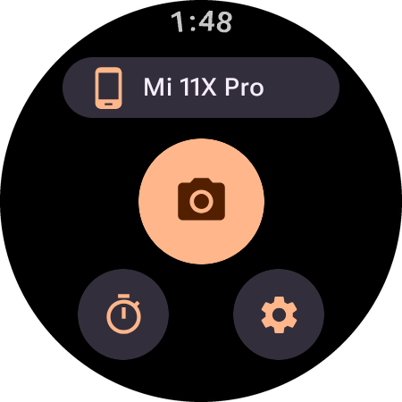
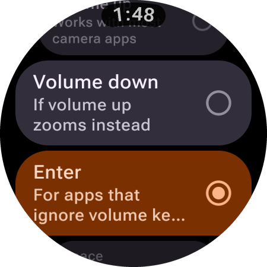

# CameraButton

A Wear OS app that turns your watch into a Bluetooth camera shutter for your phone. The watch
pairs as a Bluetooth keyboard and remote and presses the shutter in the phone's own camera app.

**No companion app needed.** Nothing is installed on the phone, and you keep its camera's full
quality and features.

  
  
  

## Features

- One-tap shutter, with a self-timer of 3, 5 or 10 seconds
- Choice of shutter key: Volume up, Volume down, Enter or Space
- Stays connected in the background, with an option to keep the screen on

## Use

1. Install the APK from [Releases](../../releases) on the watch (Wear OS 3+).
2. Open the app, tap **Pair**, then pair with the watch from the phone's Bluetooth settings.
3. Open the phone's camera and tap the shutter on the watch.

If the phone connects and then drops the link right away, remove the pairing on both sides and
pair again with the app open.
